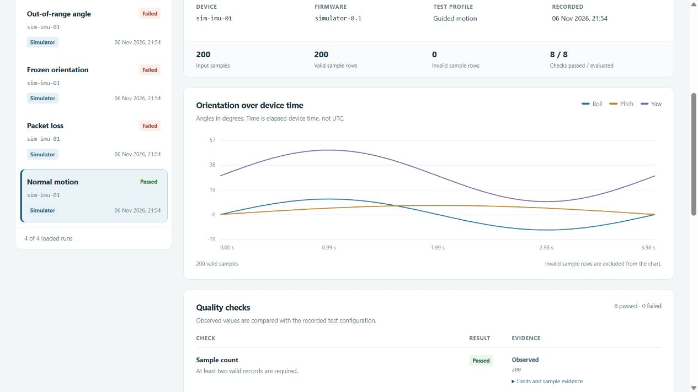
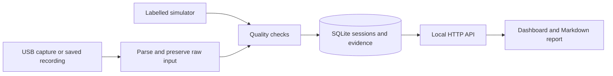

# SensorBench

SensorBench captures sensor data, runs automated quality checks, and preserves the measurements behind each test result. It combines a Python acquisition pipeline, SQLite, a local HTTP API and a browser dashboard with downloadable test reports.



## Run the demo

Use Python 3.11 or newer. On Windows, install `tzdata` with `python -m pip install tzdata` so report exports can use Helsinki time. Run these commands from the repository root.

```sh
python -m sensorbench demo
python -m sensorbench serve
```

Open [the local dashboard](http://127.0.0.1:8765). The demo adds four labelled synthetic runs. Repeating it reuses the existing sessions.

| Run | Input | Expected result |
| --- | --- | --- |
| Normal motion | 200 IMU samples with deliberate angle changes | Pass |
| Packet loss | Four missing sequence numbers and a timing gap | Fail |
| Frozen orientation | Unchanging orientation during a guided exercise | Fail |
| Out-of-range angle | A pitch value outside the supported range | Fail |

Replay the synthetic recordings to try both import formats without a physical device.

```sh
python -m sensorbench replay examples/quaternion_demo.ndjson --device sim-quaternion --profile guided_motion
python -m sensorbench replay examples/gps_rtc_demo.txt --device sim-gps --profile gps_monitoring
```

The GPS fixture uses synthetic coordinates. Install the optional MGRS converter with `python -m pip install ".[gps]"` to populate grid references, then replay and refresh the dashboard. The importer retains latitude, longitude and recorded time when the converter is unavailable.

## How a run becomes evidence



- **Acquisition.** Read GPS coordinates and DS3231 clock records from the existing ESP32 firmware or convert quaternion telemetry to roll, pitch and yaw.
- **Test automation.** Check GPS fix fields and clock order, or check IMU sequences, elapsed times and angle bounds. Run the motion response check during a guided movement exercise.
- **Traceability.** Store the original payload, versioned test configuration, input hash and evidence row indices. Each device and session pair identifies an immutable run. Identical input reuses it.
- **Troubleshooting.** Open a failed check in the dashboard to see the observed value, its limit and the underlying rows. Download the Markdown report to preserve the result.

## Verification

A physical ESP32 GPS and DS3231 session produced 11 usable records. SensorBench generated 11 MGRS grid references and passed all five GPS quality checks. The report covers format and ordering checks. Establishing position or clock accuracy would require an independent reference.

The quaternion conversion and pipeline were verified with synthetic replay and automated tests. The included combined BNO085/GPS firmware compiled for the ESP32 Dev Module target. See [verification details](docs/VERIFICATION.md) for the scope of each result.

Run the automated tests with `python -m unittest discover -s tests -v`. The GitHub Actions workflow is configured for Python 3.11–3.13 on Windows and Ubuntu.

## Code and hardware

| Area | Source |
| --- | --- |
| USB capture, GPS parsing and replay | [capture.py](sensorbench/capture.py) |
| Quality checks and evidence rows | [quality.py](sensorbench/quality.py) |
| Transactional storage and report generation | [storage.py](sensorbench/storage.py) |
| HTTP API and dashboard | [server.py](sensorbench/server.py), [index.html](sensorbench/static/index.html) |
| Quaternion conversion and ESP32 firmware | [orientation.py](sensorbench/orientation.py), [firmware](firmware/README.md) |

[Capture and replay](docs/USB_CAPTURE.md) covers setup and expected input. [Telemetry protocol](docs/QUATERNION_PROTOCOL.md) documents the quaternion fields. [Engineering decisions](docs/DECISIONS.md) explains transaction boundaries and provenance. The software baseline was developed with AI coding assistance.
